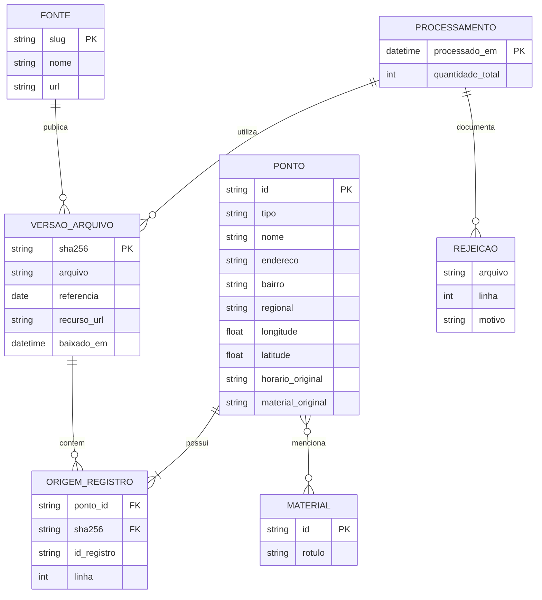

# Correspondência com os documentos

## Requisitos implementados

| Requisito | Implementação e verificação |
|---|---|
| Dados reais e conexão com a interface | Pipeline gera GeoJSON consumido por fetch em app.js; mesma coleção alimenta mapa/lista |
| Aquisição e proveniência | Manifesto fontes.json, nomes originais, referência temporal, URLs e SHA-256; desconhecidos nulos |
| Validação | Colunas, identificadores, quantidade de campos, POINT e limites do entorno de BH |
| Classificação literal | materiais_literal; texto original preservado; sem inferência pelo equipamento |
| Busca avançada | Material múltiplo (qualquer/todos), texto de localização sem acentos, regional e tipo em interseção |
| Localização | Endereço geocodificado selecionado pelo usuário, GPS ou marcação no mapa; raio e ordenação por distância |
| Georreferenciamento | pyproj EPSG:31983 → EPSG:4326; ordem GeoJSON longitude, latitude |
| Metadados descritivos | Identificador, nome, endereço, referência, bairro, regional, horário e material original |
| Metadados temáticos | Vocabulário de materiais, rótulos e critério de indexação |
| Metadados administrativos | Fonte, arquivo, linha, hash, datas, codificação, separador e colunas |
| Metadados técnicos | Formato, idioma, cobertura, CRS e ordem das coordenadas |
| Auditoria | Relatório por fonte e linha rejeitada, duplicados integrados, coordenadas coincidentes e endereços compartilhados |
| Transparência | Modal de fontes, dicionário, limitações e download de CSV bruto/tratado, GeoJSON e JSON |
| Acessibilidade e celular | HTML semântico, labels, teclado, foco visível, dialogs nativos, lista alternativa ao mapa, layouts responsivos |

## Organização e gestão dos registros

Metadados inspirados nos elementos Dublin Core (título, criador, publicador, idioma, cobertura, formato, fonte, identificador e datas), sem declarar certificação ou conformidade integral com um padrão. Os campos efetivos são documentados em dist/dados/metadados.json e expostos na interface.

A fonte é o conjunto de publicação; o tipo é uma característica do registro. Esses conceitos não são intercambiáveis. Cada identificação é prefixada por fonte e esquema para evitar colisões entre tipos. A integração de duplicados só ocorre quando atributos semânticos e coordenadas coincidem; todas as origens são preservadas. Registros com coordenadas coincidentes são sinalizados separadamente daqueles que compartilham endereço. Nenhum registro é eliminado apenas por proximidade ou coincidência de endereço.

Preservação: CSVs de aquisição permanecem intactos; cópias de integridade são endereçadas por hash e snapshots de processamento ficam em historico. A visualização corrente usa somente as versões selecionadas no manifesto. A versão de referência é extraída do nome do download quando indicada; horário de download não foi inferido da data do sistema de arquivos. A retenção e destinação formal dos registros, responsáveis por revisão e relatório acadêmico completo ainda devem ser definidos pelo grupo; não foi inventada uma tabela institucional de temporalidade.

## Modelo ER lógico

O modelo é lógico. A implementação desta entrega usa documentos GeoJSON/JSON e não exige SQL.

## Limitações de interpretação

Colchões, por exemplo, não são acrescentados ao índice de um ponto que só mencione móveis. “Carcaças de eletrodomésticos” não é apresentado como aceitação irrestrita de eletrônicos. O texto de horários não gera selo de “aberto agora”. Busca sem resultado não comprova inexistência de serviço nem proibição. Dados e regras de aceitação precisam de conferência com a PBH.

## Fontes técnicas

- https://dados.pbh.gov.br/dataset/ponto-verde
- https://dados.pbh.gov.br/dataset/unidadade-de-recebimento-de-pequenos-volumes-urpv
- https://dados.pbh.gov.br/dataset/galpao-reciclagem
- https://leafletjs.com/reference-1.9.4.html
- https://github.com/komoot/photon
- https://operations.osmfoundation.org/policies/tiles/
